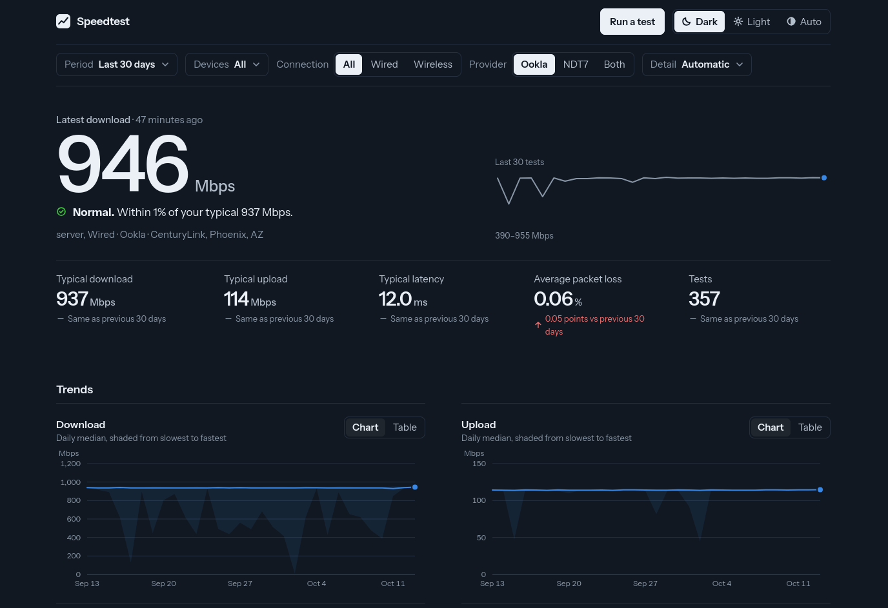

# Speedtest App

A Speedtest application for heuristic data collection, organization, and analysis built to track your homelab network's performance. 

> **Running it?** `cd deploy && ./setup.sh <your-address> && docker compose up -d --build`. Everything (database, backend, web app and a private
> ntfy notification server) comes up together. See [docs/DEPLOY.md](docs/DEPLOY.md).

This project runs speed tests on a schedule, stores every result in PostgreSQL, and shows them on a dashboard.

| Part | Where |
|---|---|
| Backend API (Go) | `backend-go/` |
| Dashboard (React, PWA, dark by default) | `frontend-react/` |
| The same dashboard in Svelte (passes the same browser tests) | `frontend-svelte/` |
| Code both dashboards share, and their browser tests | `frontend-shared/` (copied in by `scripts/sync-shared.sh`) |
| Second backend (Rust, same contract and behaviour as Go) | `backend-rust/` |
| Collector: runs the tests on a device and sends the results | `collector-go/`, guide in `docs/COLLECTOR.md` |
| Docker stack: database, backend, web app, ntfy | `deploy/`, guide in `docs/DEPLOY.md` |
| Go + React or Rust + Svelte: measurements and advice | `docs/COMPARISON.md` |
| API contract (OpenAPI) | `docs/openapi.yaml` |
| Roadmap | `docs/PLAN.md` |

Tests come from Ookla's command-line tool (which you must accept the terms of yourself) and M-Lab NDT7.

## Moving legacy data

To bring over data from the old SQL Server database, see `scripts/export_speedtests.py` (needs Python with SQLAlchemy and the
Microsoft ODBC driver) and `sql/postgres/002_migrate_data.sql`. The old Flask app and Python collector were removed; the last
copy of them is in git history (`git log --diff-filter=D --stat -- flaskapp`).
